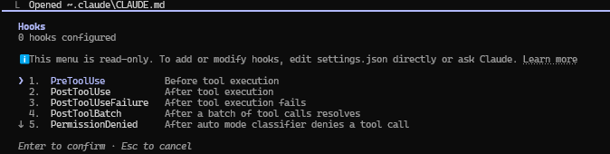

# CLAUDE CODE COURSE TUTORIAL

Apa yang harus ditaruh di `claude.md`:

1. **The What** - Your tech stack, project structure, key packages
2. **The Why** - The purpose of each component, architectural decisions
3. **The How** - How you want Claude to work with the project

Contoh Code pada project WebApi

```powershell
# CLAUDE.md - MyApp API

## Tech Stack
- .NET 10, ASP.NET Core Minimal APIs
- Entity Framework Core 10 with PostgreSQL
- Mediator for CQRS (source-generated)
- FluentValidation for request validation

## Project Structure
- `src/MyApp.Api/` - Entry point, endpoints, middleware
- `src/MyApp.Application/` - Use cases, handlers, DTOs
- `src/MyApp.Domain/` - Entities, value objects, domain events
- `src/MyApp.Infrastructure/` - EF Core, external services

## Commands
- Build: `dotnet build`
- Test: `dotnet test`
- Run: `dotnet run --project src/MyApp.Api`

## Coding Standards
- Use primary constructors for dependency injection
- Always pass CancellationToken to async methods
- Validation goes in FluentValidation validators, not handlers
- Never hardcode connection strings or secrets

## Workflow Rules
- ALWAYS create a git branch before making changes
- Run `dotnet test` after every implementation
- Keep commits atomic and focused
```

Cara membuat Claude.md otomatis:

Cara tercepat memakai builtin function yang sudah disediakan oleh claude

```powershell
/init
```

Atau bisa juga mengatur claude dalan basaha aslinya untuk mengontrol apa yang akan dipakai

```powershell
Analyze this codebase and create a CLAUDE.md file that covers:
1. Tech stack and dependencies
2. Project structure and purpose of each folder
3. Build/test/run commands
4. Coding conventions you observe
5. Workflow rules I should follow

Use progressive disclosure - keep the main file concise and link to
detailed docs in a /docs folder if needed.
```

Protips:

```powershell
Pro Tip: Treat CLAUDE.md as a living document. 
Commit it to version control so your entire team benefits. 
When coding standards evolve, update the file.
```

Setelah melakukan setup `claude.md` dengan rule "always create a git branch before making changes". Ask AI to fixing a bug.

```
There's a bug where clicking on the calendar doesn't set the correct
time for the new event. The time shown in the modal doesn't match
where I clicked.
```

Dari perintah diatas, claude menemukan bug in a TSX file, tapi sebelum perbaikan, akan meminta untuk buat branch baru seperti instruksi yang ada di `claude.md`.

### Auto Memory - Claude Takes Its Own Notes Now

Semenjak claude v.2.1.59, claude secara otomatis akan menulis untuk dirinya sendiri pada saat bekerja di project.

Note tersebut akan disimpan di `~/.claude/projects/<project>/memory/` sebagai markdown dokumen dengan index `memory.md` yang selalu di load pada saat memulai suatu sesi claude.

`claude.md` dan `memory.md`, keduanya bekerja sama

- **CLAUDE.md** - instructions and rules YOU write (coding standards, architecture, workflows)
- **Auto memory** - learnings CLAUDE writes (things it discovered or you corrected) 

Untuk mengetahui suatu memory, jalankan `/memory` di console sesi claude untuk melihat apa yang ditampilkan.

## Claude Code Plan Mode - Think Before You Code

Claude code memiliki mode rencana/Plan Mode yang secara spesifik dibuat untuk mencegah. Ketika berada di Plan Mode, Claude hanya bisa melakukan

- Read files
- Search and grep through code
- Browse the web for documentation
- Ask you clarifying questions

It **cannot** write, modify, or execute anything. It’s forced to think first.

### How to Enter Plan Mode

Tekan kombinasi kunci `Shift + Tab` untuk mengubah sampai ketemu dengan `Plan Mode` yang bisa dilihat pada indicatordi kiri atas.

Tips:

```powershell
Tip: You can also start a session directly in Plan Mode from your 
terminal with claude --permission-mode plan. 
Useful when you know the next task needs thinking before touching files.
```


### When to Use Plan Mode

Kapan menggunakan Plan Mode?

- Starting a new feature with multiple components
- Making architectural changes
- You’re not 100% sure about the approach
- Working on an unfamiliar codebase

### A Real Example

Katakanlah saya ingin membuat aplikasi pengelolaan tugas rumah tangga. Alih-alih melakukan *vibe-coding* dengan perintah samar seperti "buatkan saya aplikasi tugas rumah tangga," saya masuk ke Mode Perencanaan dan menulis:

```powershell
Build a chore management app with these requirements:
- Calendar view similar to Outlook
- Add/remove chores
- Recurring schedules
- Assign chores to team members
- Manage team members

Ask me questions to clarify requirements, tech stack preferences,
engineering constraints, and architecture decisions.
```

Claude akan menanyakan beberapa pertanyaan sesuai dengan target yang dikehendaki:

- “Should this be React, Vue, or another framework?”
- “Local storage or a backend database?”
- “Do you need authentication?”
- “Any specific UI library preferences?”

Setelah dijawab, Claude akan menuliskan beberapa detail Implementation Plan:

- Project structure
- Data models
- Component breakdown
- Implementation phases
- Key design decisions

Jika menemukan sesuatu yang tidak disetujui (cth: Claude akan memilih Javascript daripada Typescript), maka bisa diubah menjadi

```powershell
Use TypeScript instead of JavaScript.
```

Claude akan membuat ulang Implementation Plan, dan ketika sudah setuju, kita lakukan approval dan Claude akan memulai Implementasi dengan roadmap yang lebih jelas dan bersih.

## Permission Modes - Deciding How Much Claude Can Do

| Mode                                         | Runs without asking                           | Best for                            |
| -------------------------------------------- | --------------------------------------------- | ----------------------------------- |
| **Manual** (`default`)                       | Reads only                                    | Sensitive work, learning the tool   |
| **Accept edits** (`acceptEdits`)             | Reads, file edits, common filesystem commands | Iterating on code you’re reviewing  |
| **Plan** (`plan`)                            | Reads, plus exploration                       | Scoping before you change anything  |
| **Auto** (`auto`)                            | Everything, with background safety checks     | Long tasks, avoiding prompt fatigue |
| **Don’t ask** (`dontAsk`)                    | Only pre-approved tools                       | CI pipelines and scripts            |
| **Bypass permissions** (`bypassPermissions`) | Everything, no checks                         | Isolated containers and VMs only    |

## Claude Code Context Window - How It Understands Your Codebase

### How Context Works

Ketika memulai suatu sesi, Claude tidak menampilkan semua codebase dalam memory, akan tetapi Claude melakukan:

1. Reads your `CLAUDE.md` file
2. Scans the project structure
3. Loads files on-demand as needed
4. Maintains conversation history

Jika kamu melakukan suatu fitur spesifik, Claude akan membaca file yang relevan, memahami depenensi/ketergantungan dan akan mempertahankan context yang telah diiterasi.

### Managing Context

Beberapa tips yang bisa dilakukan

**Clear conversation history:** ketik`/clear` untuk me-reset conversation akan tetapi akan mempertahankan `CLAUDE.md` context.

**Use subagents for isolated tasks:** Saat Claude memunculkan sub-agen (tugas yang terfokus), sub-agen tersebut memiliki konteksnya sendiri. Hal ini mencegah membengkaknya sesi utama Anda.

**Keep CLAUDE.md concise:** Karena `CLAUDE.md` dimuat dalam setiap sesi, jangan menaruh seluruh dokumentasi Anda di sana. Jaga agar tetap ringkas dan gunakan tautan ke file eksternal untuk detail lebih lanjut.

## Claude Code Hooks - Automate Your Workflow

Hook memungkinkan Anda menjalankan tindakan kustom pada titik-titik tertentu dalam alur kerja Claude. Fitur ini berbasis peristiwa; daftar referensi hook mencakup puluhan peristiwa, namun ketiga hal berikut ini mencakup sebagian besar kasus penggunaan:

- **PreToolUse** - Runs before Claude uses a tool (like before writing a file)
- **PostToolUse** - Runs after a tool completes
- **Stop** - Runs when Claude finishes a task



## Claude Code Skills - Create Your Own Shortcuts

Anda dapat membuat *slash command* sendiri untuk mengefisienkan tugas-tugas yang berulang. Cara modern untuk melakukannya adalah dengan menggunakan *skill*: sebuah file `SKILL.md` di dalam folder `.claude/skills/<nama>/`.

Sebagai contoh, buatlah` .claude/skills/test/SKILL.md`:

```powershell
---
name: test
description: Run the test suite and fix failures
---

Run all tests for the solution and report any failures.
If tests fail, analyze the error and suggest fixes.

$ARGUMENTS
```

Nah, sekarang kamu bisa ketik /test di Claude dan akan mengeksekusi predifine prompt. Claude juga dapat mengaktifkan skill secara otomatis saat mendeteksi relevansinya dengan prompt Anda—inilah kemampuan yang tidak dimiliki oleh prompt biasa.

Catatan:

```powershell
Note: If you’ve seen older tutorials mention .claude/commands/, 
those still work - custom commands were merged into the skills system. 
A file at .claude/commands/deploy.md and a skill at .claude/skills/deploy/SKILL.md 
both create /deploy. Skills just add more: supporting files in the folder, 
frontmatter control, and auto-invocation.
```

Beberapa ide untuk Skills:

- `/pr` - Create a pull request with a structured description
- `/review` - Review the current changes for code quality
- `/migrate` - Generate an EF Core migration

## 6 Habits That Separate Good Sessions From Bad Ones

1. **Be specific.** “Add FluentValidation to CreateUserCommand: Email required and valid format, Name required max 100 chars” gets you the right code. “Can you help me add some validation?” gets you a guess.
2. **Commit before you prompt.** Claude fixes one thing and occasionally breaks another. A commit after each working change makes rollback a non-event.
3. **Read the diff.** Claude sometimes adds a dependency you didn’t ask for, or writes code that works but doesn’t match your architecture. Review it like any pull request.
4. **Plan anything non-trivial.** More than two or three files, or any architectural call, start in Plan Mode. Assumptions made in the first minute compound for the next hour.
5. **Invest in `CLAUDE.md`.** Especially the patterns you *don’t* want. “No repository pattern, we use EF Core directly” saves the same argument every session.
6. **Push back.** Say “no, use X instead” and Claude adapts. The best results come from dialogue, not accepting the first suggestion.

## Troubleshooting Common Claude Code Issues

Ini adalah beberapa masalah yang sering ditanyakan.

### Start With /doctor

Sebelum Anda men-debug apa pun secara manual, jalankan pemeriksaan bawaan:

```powershell
/doctor
```

Perintah ini mendiagnosis instalasi dan konfigurasi Anda dalam satu langkah—meliputi kondisi instalasi, kesalahan validasi pada berkas pengaturan, serta hasil upaya pembaruan terakhir—dan untuk banyak masalah, sistem akan menawarkan perbaikan otomatis bagi Anda. `/checkup` adalah alias untuk fungsi yang sama.

Tersedia juga versi yang dapat Anda jalankan tanpa memulai sesi; inilah versi yang sebaiknya digunakan jika Claude Code sama sekali tidak mau berjalan:

```powershell
claude doctor
```

Ini mencetak diagnostik hanya baca dan saran perbaikan. Sebagian besar laporan "Claude Code rusak" ternyata disebabkan oleh instalasi yang usang atau settings.json yang salah format, dan keduanya dapat mendeteksinya dalam hitungan detik.

### How to Fix npm Install Permission Errors

Jangan gunakan `sudo npm install -g`. Sebagai gantinya, perbaiki izin akses npm:

```powershell
mkdir ~/.npm-global
npm config set prefix '~/.npm-global'
export PATH=~/.npm-global/bin:$PATH
```

Tambahkan baris terakhir tersebut ke dalam `.bashrc` atau `.zshrc` Anda agar bersifat permanen. Kemudian, jalankan kembali instalasi tanpa sudo.

### Why Doesn’t Claude Code Understand My Project Structure?

Ini biasanya berarti Claude belum membaca konteks yang cukup. Coba:

1. **Create a `CLAUDE.md` file** - This is the single biggest improvement you can make.
2. **Explicitly tell Claude to explore** - Say “Read the project structure and understand the architecture before making changes.”
3. **Point Claude to key files** - “Look at `src/Application/` to understand how we structure commands and handlers

### How to Prevent Claude Code From Making Unwanted Changes

Hal ini bisa terjadi. Claude terkadang "menyempurnakan" kode saat memperbaiki bagian lain. Berikut adalah beberapa cara untuk mencegahnya:

- **Be explicit about scope** - “Only modify the `UserService` class. Don’t touch anything else.”
- **Add rules to `CLAUDE.md`** - “Never refactor code unless explicitly asked.”
- **Use Plan Mode** - Review the plan before Claude executes. If you see unrelated changes, tell it to remove them

### What to Do When Claude Code Forgets Earlier Instructions

Sesi yang panjang dapat menghabiskan konteks. Saat hal ini terjadi:

1. **Type `/clear`** - This resets the conversation but keeps your `CLAUDE.md` loaded.
2. **Start a new session** - Close and reopen Claude Code. Fresh context.
3. **Summarize before continuing** - After `/clear`, paste a brief summary: “We’re building X. We’ve completed Y. Next step is Z.”

### How to Stop Claude Code From Suggesting Unwanted Patterns

Cantumkan preferensi Anda di CLAUDE.md. Sampaikan secara eksplisit:

```powershell
## Patterns We Use
- Mediator for CQRS
- Result<T> pattern for error handling
- FluentValidation for all request validation

## Patterns We DON'T Use (Never suggest these)
- Repository pattern (we use EF Core directly)
- AutoMapper (we write explicit mappings)
- Exceptions for control flow
```

Claude mematuhi aturan-aturan ini secara konsisten setelah aturan tersebut didokumentasikan.

### 
